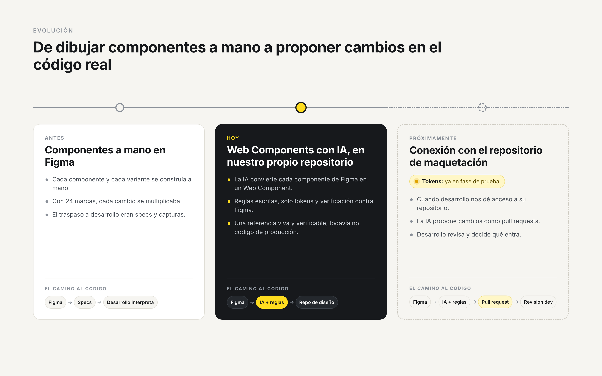
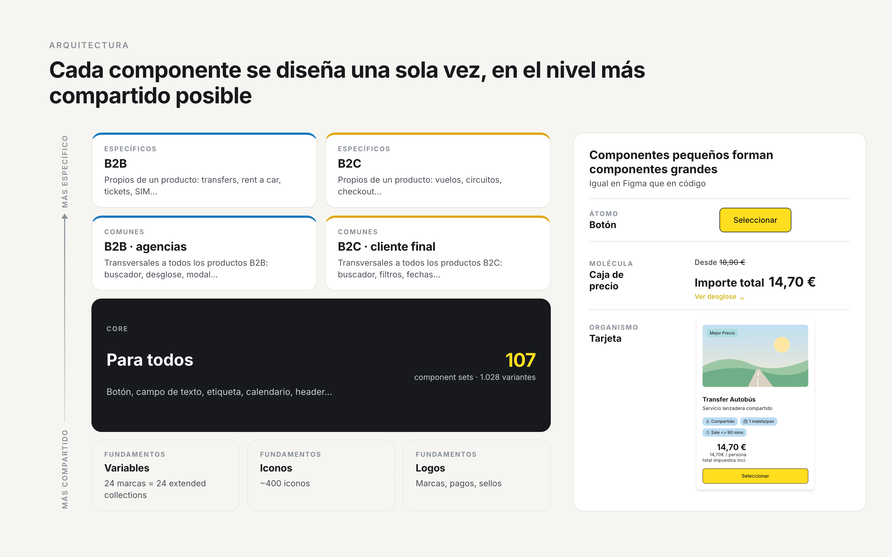
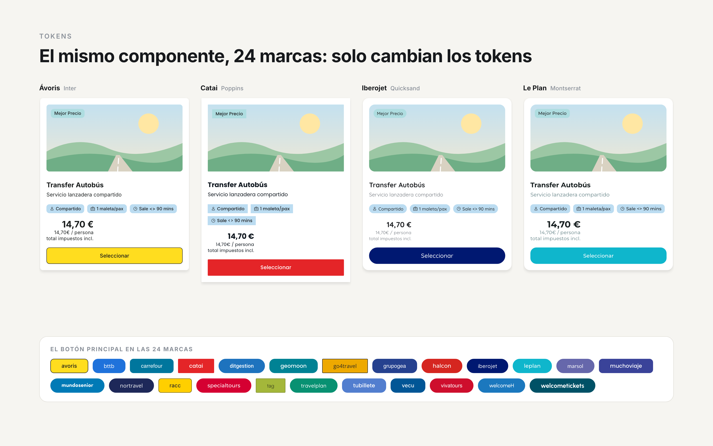
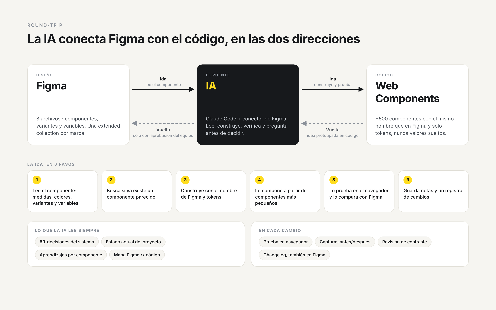
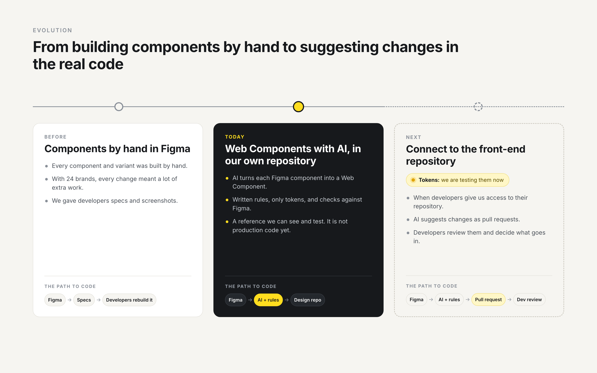
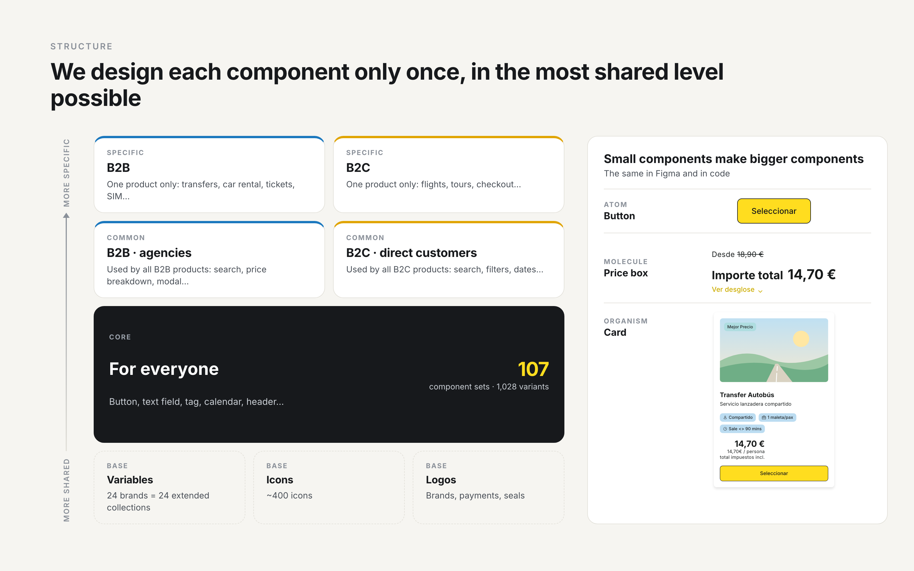
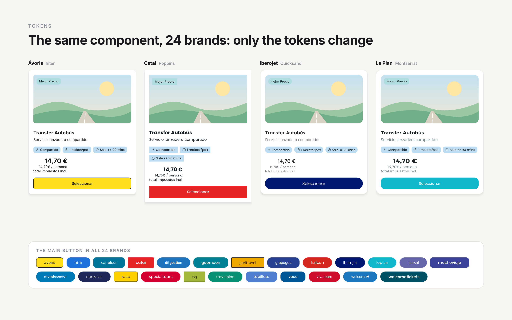
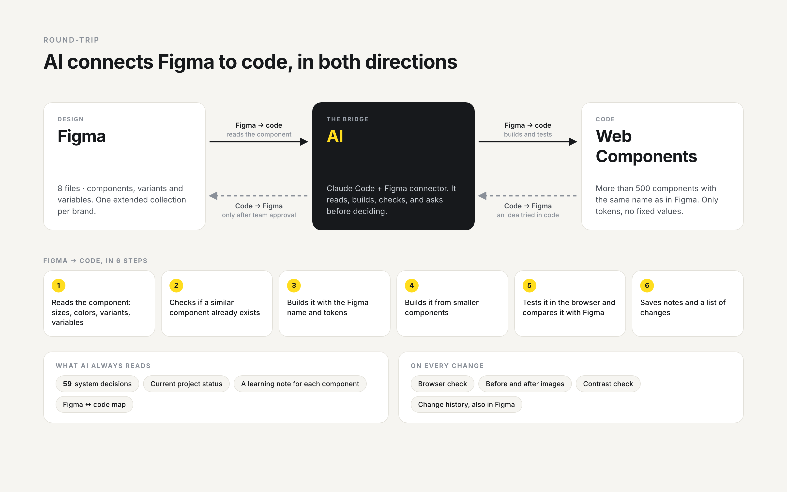

# Caso de estudio para el portfolio: Ávoris Design System

Dos versiones del mismo caso: **español** primero y **English** después. Cada sección lleva una
sugerencia de imagen (📷) y al final hay una lista de datos a confirmar antes de publicar.

---

# 🇪🇸 ESPAÑOL

## Ávoris Design System
### Un sistema de diseño multimarca conectado a código con IA

| | |
|---|---|
| **Empresa** | Ávoris (grupo turístico multimarca) |
| **Equipo** | 4 personas de diseño de producto / Design System |
| **Mi rol** | Product designer en el equipo de Design System |
| **Herramientas** | Figma (variables y extended collections, componentes y variantes), Web Components, Claude Code + conector de Figma, Markdown |
| **Alcance** | 8 archivos de Figma · 24 marcas · B2B y B2C · vuelos, hoteles, transfers, coches, tickets, circuitos… |

📷 *Portada: collage de componentes de distintas marcas con el mismo layout, o la portada de la presentación del DS.*

---

### El contexto

El sistema tenía que dar servicio a tres ejes a la vez:

- **24 marcas.** Cada una tiene sus propios colores, formas y logo: B travel, Halcón Viajes, Marsol,
  Iberojet, Muchoviaje, Travelplan, Welcome, Catai…
- **Muchas líneas de negocio:** vuelos, hoteles, transfers, alquiler de coches, tickets, circuitos y
  más. Cada línea necesita sus propios componentes especiales.
- **Dos audiencias:**
  - **B2B:** las agencias de viajes que venden nuestros viajes.
  - **B2C:** los clientes que reservan directamente.

Todas las combinaciones comparten la misma lógica de producto: buscar, comparar, reservar y pagar.
Sin un sistema común, cada producto reconstruía los mismos componentes una y otra vez.

**Un sistema, muchas combinaciones.** Los componentes compartidos se construyen una vez, y encima se añaden
los componentes propios de cada marca y de cada línea de negocio.

📷 *La diapositiva "¿Para quién es?" de la presentación: las 3 tarjetas (24 marcas, líneas de negocio,
dos audiencias) y la franja con logos de algunas marcas.*

### El problema

**Diseño y código vivían en mundos separados.**

- Los componentes se construían a mano en Figma, variante a variante. Con 24 marcas, cada cambio se
  multiplicaba.
- El paso a código dependía de un traspaso: desarrollo interpretaba el diseño y lo maquetaba, y en
  cada traspaso podían colarse pequeñas diferencias.
- Diseño aún no tiene acceso al repositorio de maquetación, así que todavía no puede comprobar ni
  proponer cambios en el código real.

No bastaba con tener una librería en Figma. Necesitábamos que **el propio equipo de diseño pudiera llevar
el diseño a código**, sin esperar a ese acceso, y dejarlo todo preparado para conectarlo con el código real en cuanto sea
posible.

📷 *Antes: un componente con todas sus variantes construidas a mano en Figma.*

---

### De dónde venimos y adónde vamos

| | Etapa | Cómo trabajamos |
|---|---|---|
| **Antes** | Componentes a mano en Figma | Cada componente y cada variante se construía a mano. El traspaso a desarrollo eran specs y capturas. |
| **Hoy** | Web Components con IA, en nuestro propio repositorio | La IA convierte cada componente de Figma en un Web Component, siguiendo nuestras reglas, con tokens y verificación contra Figma. Es un repositorio de diseño: una referencia viva y verificable, todavía no el código de producción. |
| **Próximamente** | Conexión con el repositorio de maquetación | Cuando desarrollo organice su repositorio y nos dé acceso, la IA podrá proponer cambios como *pull requests* que desarrollo revisa y aprueba. Desarrollo mantiene el control de lo que entra. |

Todo lo construido hoy está pensado para ese paso: los mismos nombres que en Figma, solo tokens, las
reglas escritas y un mapa Figma ↔ código. Conectarlo al repositorio real será un cambio de destino,
no empezar de cero.

**El camino hacia el repositorio real, paso a paso:**

1. **Tokens: en fase de prueba.** Es el primer punto de conexión con desarrollo. Las variables de
   Figma de las 24 marcas se exportan automáticamente a una hoja de tokens en código: cambiar de marca
   es cambiar un atributo, sin tocar los componentes. Ahora mismo estamos probando este paso.
2. **Componentes del DS**, mediante *pull requests* que revisa desarrollo.
3. **Mapear cada componente de Figma con su código real**, para que diseño y desarrollo hablen del
   mismo componente.

---

### El equipo y mi papel

El Design System es el trabajo de **un equipo de 4 personas de diseño**. Juntos trabajamos el sistema
de punta a punta:

1. **Arquitectura en Figma.** Estructura en 8 archivos, componentes y variantes, variables con una extended collection por marca.
2. **El flujo Figma ↔ código con IA.** El proceso por el que la IA lee Figma, construye el componente en código, lo verifica y devuelve los cambios a Figma.
3. **Gobernanza.** Las reglas que siguen las personas y la IA: naming, tokens, reutilización y cuándo preguntar en lugar de decidir.
4. **Adopción.** Presentaciones y documentación en lenguaje sencillo para equipos de diseño, desarrollo y negocio.

**Mi aportación:** *[completa con lo que fue tuyo dentro del equipo, por ejemplo: "lideré el flujo
Figma ↔ código con IA y escribí buena parte de las reglas"].*

---

### 1. Arquitectura: tres niveles de alcance

Organizamos el sistema en **8 archivos de Figma**, según **dónde se usa** cada componente:

- **CORE: componentes para todos.** Los elementos básicos que usan todos los productos, sean B2B o B2C:
  botón, campo de texto, etiqueta, checkbox, calendario, tabs, header…
- **Comunes: componentes transversales dentro de B2B o de B2C.** Se repiten en todos los productos de esa
  línea (vuelos, tickets, paquetes, circuitos, rent a car…), así que se diseñan una sola vez. Por
  ejemplo: el buscador, el selector de fechas y de pasajeros, los filtros, el desglose de precio, la
  tarjeta de reserva o los modales. Hay un archivo para B2B y otro para B2C.
- **Específicos: componentes propios de un solo producto**, también separados en B2B y B2C. Solo tienen
  sentido en ese producto:
  - **Vuelos:** tarjeta de vuelo, tarjeta de tarifas, selector de ida y vuelta.
  - **Rent a car:** tarjeta de coche, mapa con las oficinas, tarjeta de seguro.
  - **Transfers:** tarjeta de transfer, itinerario con las paradas.
  - **Tickets:** cabecera con buscador de actividades, opciones de entradas por tipo de asistente.
  - **Tarjetas SIM:** comprobador de compatibilidad del móvil, cambio de plan.
  - **Circuitos:** buscador de circuitos.
  - **Checkout:** caja de código de descuento, consentimientos legales, botones de pago.

| Nivel | Para quién | Ejemplos |
|---|---|---|
| **CORE** | Todos los productos, B2B y B2C | Botón, campo de texto, etiqueta, calendario |
| **Comunes** | Todos los productos de B2B, o todos los de B2C | Buscador, filtros, desglose de precio, modal |
| **Específicos** | Un solo producto, en B2B o en B2C | Tarjeta de vuelo, mapa de oficinas de coches, itinerario de transfer |

Más tres archivos de base: **Iconos, Logos y Variables**.

**¿Dónde va cada componente?** Cuando aparece un componente nuevo, el equipo se pregunta quién lo va a
usar y lo coloca en el nivel más compartido posible:

- Si lo usan todos los productos, B2B y B2C, va a **CORE**. Por ejemplo, un botón.
- Si lo usan todos los productos de B2C, pero solo de B2C, va a **Comunes B2C**. Por ejemplo, el
  selector de pasajeros.
- Si solo tiene sentido en vuelos, va a **Específicos**. Por ejemplo, la tarjeta de tarifas.

Así cada componente se diseña una sola vez: no hay una versión para vuelos y otra casi igual para
circuitos, y todos los productos se ven igual.

**Componentes pequeños forman componentes grandes.** Además del nivel, cada componente se clasifica
por su tamaño:

- **Átomo:** el componente más pequeño. Por ejemplo, un botón.
- **Molécula:** varios átomos juntos. Por ejemplo, la caja de precio.
- **Organismo:** un bloque grande hecho de componentes más pequeños. Por ejemplo, la tarjeta de transfer,
  que lleva dentro etiquetas, la caja de precio y el botón.

La tarjeta no dibuja su propio botón: usa el mismo botón que el resto del sistema, en Figma y en
código. Si cambia el botón, cambia en todas las tarjetas.

### 2. Tokens: un solo componente para 24 marcas

Nunca escribimos "este azul". Escribimos un nombre, como `button-primary-bg`.

- **En Figma**, el archivo de Variables tiene unas colecciones base con los valores por defecto, y
  **cada marca es una extended collection** que hereda de ellas. La marca solo sobrescribe lo que
  cambia (colores, radios, tipografía…); todo lo demás lo hereda de la base.
- **En el repositorio**, los tokens se generan automáticamente desde Figma:
  1. Un script lee las variables del archivo de Variables de Figma.
  2. Para cada marca, resuelve qué valor le toca a cada token: el que la marca sobrescribe o, si no lo
     sobrescribe, el que hereda de la base.
  3. Con eso genera **un único archivo de tokens** con un bloque por marca (por ejemplo,
     `[data-brand="halcon"]`).
  4. Para cambiar de marca basta con cambiar el atributo `data-brand` de la página. No hay que cargar
     otro archivo ni tocar los componentes.
- Cambias el valor de un token y cambian todos los componentes que lo usan.

### 3. El puente: el round-trip con IA

La IA conecta Figma con el código **en las dos direcciones**, para que diseño y código se mantengan
sincronizados:

**Figma → código.** A partir de un enlace de Figma, la IA:
1. Lee el componente: medidas, colores, variantes y las variables que hay detrás.
2. Busca si ya existe un componente parecido, para no duplicar.
3. Construye el Web Component con **el mismo nombre que en Figma** y con tokens, sin valores sueltos.
4. Lo compone a partir de componentes más pequeños, como en Figma.
5. Lo prueba en el navegador y lo compara con Figma.
6. Guarda notas y un registro de cambios.

**Código → Figma.** Una idea prototipada en código puede volver a Figma, **siempre después de que el
equipo la apruebe**.

Los pedidos son en lenguaje natural: *"Construye este componente desde Figma"*, *"La tarjeta tiene una
variante nueva, actualiza el código"*, *"Lleva este componente a Figma"*.

📷 *Pendiente: captura antes/después con un nodo de Figma junto a su Web Component.*

### 4. Gobernanza: reglas que la IA siempre lee

Para que la IA trabaje como una más del equipo, y no como una caja negra, escribimos **59 decisiones de
sistema** (D0–D58) en un documento único. Algunos ejemplos:

- **Usa tokens.** Todo color y tamaño viene de una variable.
- **Mismo nombre que en Figma.** Un componente se llama igual en diseño y en código.
- **Reutiliza, no reconstruyas.** Primero buscar, después crear.
- **"Completo" significa completo.** Un componente solo está terminado si cubre **todas** sus variantes reales. Si no, es "parcial", con el detalle de lo que falta.
- **Pregunta antes de los cambios grandes.** ¿Un layout nuevo? La IA avisa primero. ¿Una errata en Figma? La señala, nunca la corrige en silencio.

Además, el proyecto **tiene memoria**: un checkpoint vivo de estado, una ficha de aprendizajes por
componente y un mapa Figma ↔ código. Cualquier persona, o una nueva sesión de IA, puede retomar el
trabajo justo donde se dejó.

📷 *Captura del documento de decisiones o de una ficha de aprendizajes (recortada).*

### 5. Calidad en cada cambio

Que la IA construya un componente no significa que esté bien. Por eso cada vez que se crea o se cambia
uno, pasa por las mismas comprobaciones:

- **Se compara con Figma en el navegador.** El componente en código se abre en un navegador, como lo
  vería un usuario, y se compara con el diseño de Figma: medidas, colores y todas sus variantes. Si
  no coinciden, no se da por terminado.
- **Se guardan capturas del antes y el después.** Una de Figma y otra del componente en código. Así
  queda la prueba de lo que se comprobó y cualquiera puede ver qué cambió.
- **Se revisa la accesibilidad de los colores nuevos.** Si aparece un color de texto o de fondo que no
  existía en el sistema, se calcula su contraste para asegurar que se lee bien, también para personas
  con baja visión (nivel AA de las pautas de accesibilidad WCAG).
- **Cada componente tiene su historial de cambios.** Se apunta qué cambió y por qué. Ese resumen
  también se escribe en la descripción del componente dentro de Figma, así que un diseñador lo ve sin
  salir de su herramienta.
- **Figma y el código se comparan de forma automática.** Un script revisa los archivos de Figma y avisa
  de lo que no está al día en el código: componentes nuevos, componentes eliminados o variantes que han
  cambiado. Con eso se crea una lista de tareas que el equipo trabaja con la IA.

📷 *Viewer local con un componente y sus estados, o una entrada del changelog.*

---

### Resultados

- **CORE completo:** 107 component sets y **1.028 variantes** cubiertas al 100%.
- **Los 7 archivos de componentes** (CORE, Iconos, Logos, B2B y B2C comunes y específicos) cerrados con el alcance definido.
- **Más de 500 Web Components** construidos y verificados en nuestro repositorio de diseño, organizados en átomos, moléculas y organismos.
- **~400 iconos** y los componentes de logos, certificaciones y métodos de pago en código.
- **Más de 450 fichas de aprendizajes** por componente: el conocimiento queda escrito y no depende de una persona.
- Un mismo componente sirve a **24 marcas** cambiando solo los tokens.

> *[Añadir si tienes el dato: tiempo medio para crear un componente antes/después, nº de equipos o
> productos que lo usan, feedback del equipo.]*

### Lo que aprendimos

- **La IA rinde tanto como las reglas que le das.** Lo que más valor aportó no fue generar código, sino escribir las decisiones de forma que una persona y una IA las lean igual.
- **Que la IA pregunte vale más que la velocidad.** Señalar una errata o un duplicado en vez de "arreglarlo" en silencio hizo que las decisiones siguieran siendo del equipo.
- **"Completo" necesita una definición.** Medir la cobertura con las variantes reales de Figma, no con una estimación, evitó dar por cerrados componentes a medias.
- **Documentar es diseñar.** Un sistema para 24 marcas solo escala si cualquiera puede entender por qué está hecho así.

### Próximos pasos

- **Conectar con el repositorio de maquetación** en cuanto tengamos acceso, con cambios propuestos como
  *pull requests* que revisa desarrollo.
- Cerrar la fase de prueba de los tokens y llevarlos al repositorio de maquetación.
- Adaptación de componentes al ancho real (responsive).
- Revisión con el equipo de los duplicados y anomalías de naming detectados.

---
---

# 🇬🇧 ENGLISH

## Ávoris Design System
### A design system for many brands, connected to code with AI

| | |
|---|---|
| **Company** | Ávoris (a travel group with many brands) |
| **Team** | 4 people in product design / Design System |
| **My role** | Product designer in the Design System team |
| **Tools** | Figma (variables and extended collections, components and variants), Web Components, Claude Code + Figma connector, Markdown |
| **Scope** | 8 Figma files · 24 brands · B2B and B2C · flights, hotels, transfers, cars, tickets, tours… |

📷 *Cover: a collage of components from different brands with the same layout, or the cover of the DS presentation.*

---

### The context

The system had to work for three things at the same time:

- **24 brands.** Each brand has its own colors, shapes and logo: B travel, Halcón Viajes, Marsol,
  Iberojet, Muchoviaje, Travelplan, Welcome, Catai…
- **Many lines of business:** flights, hotels, transfers, car rental, tickets, tours and more. Each
  line needs its own special components.
- **Two audiences:**
  - **B2B:** the travel agencies that sell our trips.
  - **B2C:** the customers who book directly with us.

All these combinations follow the same product logic: search, compare, book and pay. Without a
shared system, each product built the same components again and again.

**One system, many combinations.** We build the shared components only once. Then, on top of them,
we add the components that belong to each brand and to each line of business.

📷 *The "Who is it for?" slide from the presentation: the 3 cards (24 brands, lines of business, two
audiences) and the row with the logos of some brands.*

### The problem

**Design and code lived in separate worlds.**

- We built the components by hand in Figma, one variant after another. With 24 brands, every change
  meant much more work.
- To get to code, we had to hand over the design: developers read the design and built it in code.
  Every time we did this, small differences could appear.
- The design team doesn't have access to the front-end code repository yet, so we still can't check
  or suggest changes in the real code.

Having a library in Figma was not enough. We needed **the design team itself to be able to take the
design to code**, without waiting for that access. And we needed to have everything ready, so we can
connect it to the real code as soon as possible.

📷 *Before: a component with all its variants built by hand in Figma.*

---

### Where we come from and where we are going

| | Stage | How we work |
|---|---|---|
| **Before** | Components by hand in Figma | We built every component and every variant by hand. To hand over the design to the developers, we gave them specs and screenshots. |
| **Today** | Web Components with AI, in our own repository | AI turns each Figma component into a Web Component. It follows our rules, uses tokens and checks the result against Figma. This is a design repository: a reference that is alive and that we can check, but it is not production code yet. |
| **Next** | Connecting to the front-end repository | When the developers organize their repository and give us access, AI will be able to suggest changes as *pull requests*. The developers review and approve them. The developers keep control of what goes into the code. |

Everything we build today is ready for that step: the same names as in Figma, only tokens, written
rules and a map between Figma and code. Connecting it to the real repository will only change where
the work goes. We won't need to start from zero.

**The way to the real repository, step by step:**

1. **Tokens: in a testing phase.** This is the first connection point with the developers. The Figma
   variables of the 24 brands are exported automatically to a token file in code. To change the
   brand, you only change one attribute. You don't touch the components. We are testing this step
   right now.
2. **The DS components**, with *pull requests* that the developers review.
3. **Link each Figma component to its real code**, so design and development talk about the same
   component.

---

### The team and my role

The Design System is the work of **a team of 4 designers**. Together we worked on the system from
start to finish:

1. **Structure in Figma.** A structure of 8 files, components and variants, and variables with one extended collection for each brand.
2. **The Figma ↔ code flow with AI.** The process in which AI reads Figma, builds the component in code, checks it and sends the changes back to Figma.
3. **Rules.** The rules that people and AI follow: naming, tokens, reuse, and when to ask instead of deciding.
4. **Sharing the system.** Presentations and documentation in simple language for the design, development and business teams.

**My part:** *[write what you did in the team, for example: "I led the Figma ↔ code flow with AI and
wrote a big part of the rules"].*

---

### 1. Structure: three levels

We organized the system into **8 Figma files**, based on **where each component is used**:

- **CORE: components for everyone.** The basic elements that all products use, B2B or B2C: button,
  text field, tag, checkbox, calendar, tabs, header…
- **Common: components shared inside B2B or inside B2C.** They repeat in all the products of that
  line (flights, tickets, packages, tours, car rental…), so we design them only once. For example:
  the search bar, the date picker and the passenger picker, the filters, the price breakdown, the
  booking card or the modals. There is one file for B2B and another file for B2C.
- **Specific: components that belong to only one product**, also split into B2B and B2C. They only
  make sense in that product:
  - **Flights:** flight card, fare card, outbound and return selector.
  - **Car rental:** car card, map with the offices, insurance card.
  - **Transfers:** transfer card, route with the stops.
  - **Tickets:** header with an activity search, ticket options for each type of visitor.
  - **SIM cards:** phone compatibility check, change of plan.
  - **Tours:** tour search.
  - **Checkout:** discount code box, legal consents, payment buttons.

| Level | Who it is for | Examples |
|---|---|---|
| **CORE** | All products, B2B and B2C | Button, text field, tag, calendar |
| **Common** | All B2B products, or all B2C products | Search bar, filters, price breakdown, modal |
| **Specific** | Only one product, in B2B or in B2C | Flight card, map of car rental offices, transfer route |

There are also three base files: **Icons, Logos and Variables**.

**Where does each component go?** When we need a new component, the team asks who is going to use
it, and puts it in the most shared level possible:

- If all products use it, B2B and B2C, it goes to **CORE**. For example, a button.
- If all B2C products use it, but only B2C, it goes to **Common B2C**. For example, the passenger
  picker.
- If it only makes sense in flights, it goes to **Specific**. For example, the fare card.

This way we design each component only once: there isn't one version for flights and another one,
almost the same, for tours. And all products look the same.

**Small components make big components.** Apart from the level, we also classify each component by
its size:

- **Atom:** the smallest component. For example, a button.
- **Molecule:** a few atoms together. For example, the price box.
- **Organism:** a big block made of smaller components. For example, the transfer card. It has tags,
  the price box and the button inside.

The card doesn't draw its own button: it uses the same button as the rest of the system, in Figma and
in code. If the button changes, it changes in all the cards.

### 2. Tokens: one component for 24 brands

We never write "this blue". We write a name, like `button-primary-bg`.

- **In Figma**, the Variables file has some base collections with the default values, and **each
  brand is an extended collection** that inherits its values from them. The brand only changes the
  values that are different (colors, corner radius, fonts…). Everything else comes from the base.
- **In the repository**, the tokens are created automatically from Figma:
  1. A script reads the variables from the Figma Variables file.
  2. For each brand, it decides the value of each token: the value the brand changes or, if the
     brand doesn't change it, the value it inherits from the base.
  3. With this, it creates **one single token file**, with one block for each brand (for example,
     `[data-brand="halcon"]`).
  4. To change the brand, you only need to change the `data-brand` attribute of the page. You don't
     need to load another file or touch the components.
- If you change the value of a token, all the components that use it change too.

### 3. The bridge: the AI round-trip

AI connects Figma and code **in both directions**, so design and code stay in sync:

**Figma → code.** Starting from a Figma link, AI:
1. Reads the component: sizes, colors, variants and the variables behind them.
2. Checks if a similar component already exists, so we don't have duplicates.
3. Builds the Web Component with **the same name as in Figma** and with tokens, without fixed values.
4. Builds it from smaller components, like in Figma.
5. Tests it in the browser and compares it with Figma.
6. Saves notes and a record of the changes.

**Code → Figma.** An idea that we prototype in code can go back to Figma, **always after the team
approves it**.

We ask AI in normal language: *"Build this component from Figma"*, *"The card has a new variant,
update the code"*, *"Take this component to Figma"*.

📷 *To do: before and after image, with a Figma node next to its Web Component.*

### 4. Rules: what AI always reads

We want AI to work like one more person in the team, not like a black box. So we wrote **59 system
decisions** (D0–D58) in one single document. Some examples:

- **Use tokens.** Every color and every size comes from a variable.
- **Same name as in Figma.** A component has the same name in design and in code.
- **Reuse, don't rebuild.** First search, then create.
- **"Complete" means complete.** A component is only finished if it has **all** its real variants. If
  not, it is "partial", with a note about what is missing.
- **Ask before big changes.** A new layout? AI tells us first. A typo in Figma? AI points it out, and
  never fixes it without telling us.

The project also **has a memory**: a live document with the current status, a learning note for each
component and a map between Figma and code. Anyone, or a new AI session, can continue the work
exactly where it stopped.

📷 *Image of the decisions document or of a learning note (cropped).*

### 5. Quality on every change

When AI builds a component, that doesn't mean the component is right. So every time we create or
change one, it goes through the same checks:

- **We compare it with Figma in the browser.** We open the component in code in a browser, the way a
  user would see it, and we compare it with the Figma design: sizes, colors and all its variants. If
  they don't match, the component is not finished.
- **We save images of before and after.** One from Figma and one of the component in code. This way
  we have proof of what we checked, and anyone can see what changed.
- **We check the accessibility of new colors.** If a text or background color appears that didn't
  exist in the system, we calculate its contrast to make sure it is easy to read, also for people
  with low vision (level AA of the WCAG accessibility guidelines).
- **Each component has its own history of changes.** We write down what changed and why. This summary
  is also written in the description of the component inside Figma, so a designer can see it
  without leaving Figma.
- **Figma and code are compared automatically.** A script checks the Figma files and tells us what is
  not up to date in the code: new components, deleted components or variants that changed. With
  this, it creates a list of tasks that the team works on with AI.

📷 *The local viewer with a component and its states, or an entry from the change history.*

---

### Results

- **CORE complete:** 107 component sets and **1,028 variants**, 100% covered.
- **The 7 component files** (CORE, Icons, Logos, B2B and B2C common and specific) are finished for
  the scope we defined.
- **More than 500 Web Components** built and checked in our design repository, organized in atoms,
  molecules and organisms.
- **About 400 icons**, and the components for logos, certifications and payment methods in code.
- **More than 450 learning notes**, one for each component: the knowledge is written down and doesn't
  depend on one person.
- The same component works for **24 brands** by changing only the tokens.

> *[Add this if you have the data: average time to build a component before and after, number of
> teams or products that use it, feedback from the team.]*

### What we learned

- **AI is as good as the rules you give it.** The most valuable part was not creating code. It was
  writing our decisions in a way that a person and an AI understand in the same way.
- **An AI that asks is worth more than speed.** When AI found a typo or a duplicate, it pointed it out
  instead of "fixing" it without telling us. This way, the decisions stayed with the team.
- **"Complete" needs a definition.** We measured our progress against the real variants in Figma, not
  with an estimate. This stopped us from closing components that were only half finished.
- **Documenting is designing.** A system for 24 brands can only grow if anyone can understand why it
  is made this way.

### Next steps

- **Connect to the front-end repository** as soon as we have access, with changes suggested as
  *pull requests* that the developers review.
- Finish the testing phase of the tokens and move them to the front-end repository.
- Adapt the components to the real screen width (responsive).
- Review with the team the duplicates and naming problems we found.

---
---

## ✅ Antes de publicar, confirma

- **24 marcas / 24 brands:** confirmado, `tokens/brands.css` tiene 24 bloques de marca (la imagen de marcas las muestra todas).
- **Líneas de negocio:** la lista sale de los prefijos de los componentes (`fly-`, `trf-`, `car-`, `tkt-`, `cir-`). Usa la lista oficial si la tienes.
- **Comparación automática Figma ↔ código:** el script existe (`scripts/figma-sync/`), pero en este ordenador no está programado para ejecutarse solo y la lista de pendientes no se actualiza desde el 2 de agosto. Por eso el texto no dice «cada semana».
- **Tu aportación:** el texto habla ahora en nombre del equipo de 4 personas de diseño. Completa la línea "Mi aportación" / "My contribution" con lo que fue tuyo, para que quien lea el portfolio sepa qué hiciste tú.
- **Imagen de las tarjetas:** la foto de las tarjetas es una ilustración neutra (en el repo no hay fotos reales). Las tipografías de Halcón, Vivatours y otras marcas no están en Google Fonts: en la tira de botones salen con fuente de sustitución.
- **Confidencialidad:** aunque puedas nombrar a Ávoris, revisa que las capturas no muestren datos de clientes, precios reales ni enlaces internos de Figma.
- **Resultados de negocio:** no hay métricas de tiempo o adopción en el repo. Si las tienes, son lo que más fuerza da al caso.
